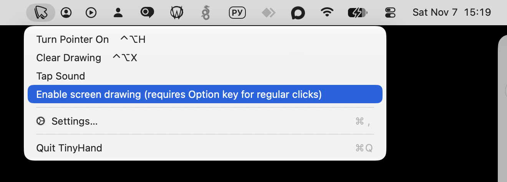

# TinyHand

[](https://github.com/sergvax/tinyhand/releases/latest)
[](https://tinyhand.app)
[](./LICENSE)

A tiny hand on a stick that points at things on your Mac screen.


[](https://github.com/sergvax/tinyhand/releases/latest/download/TinyHand.dmg)
[](https://tinyhand.app)

macOS 13 or later. The release in this fork is built for Apple Silicon.

## Click-through mode

This fork makes clicking through the hand the default. The hand still follows the
cursor and animates each tap, but every click and drag goes straight to the app
underneath — no Option key needed.

To draw on the screen again, turn on **Enable screen drawing (requires Option key
for regular clicks)** in the menu bar menu or in **Settings → General → Screen
drawing**. With screen drawing on, TinyHand behaves like the original: click to
tap, drag to draw, and hold **⌥ Option** for a regular click.

The choice is saved in `UserDefaults`, so it survives relaunches. It is off by
default.



## Install

Open `TinyHand.dmg`, drag TinyHand to Applications and allow **Accessibility**
when asked. It needs that to animate taps and to capture clicks while drawing.

This fork's builds are ad-hoc signed and not notarized. If macOS blocks the app,
right-click it and choose **Open**, or run:

```sh
xattr -dr com.apple.quarantine /Applications/TinyHand.app
```

## Use

| | |
|---|---|
| Click the menu bar icon, or **⌃⌥H** | Turn the pointer on or off |
| Right-click the menu bar icon | Menu and Settings |
| Click | Click through the hand to the app underneath |
| Hold and drag | Draw on the screen (screen drawing on) |
| Hold **⌥** and click | Regular click (screen drawing on) |
| **⌃⌥X** | Clear the drawing |
| **Esc** | Clear everything and turn the pointer off |

While the pointer is on, a small toolbar at the bottom of the screen lets you pick one of
36 hands or a laser dot, mute the tap sound, or exit.

## License

MIT. See [LICENSE](LICENSE).
